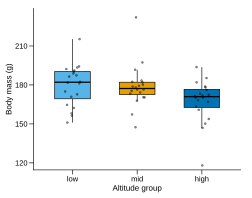

# 06 · 章节作者规范

本文件是内容作者的唯一操作手册。它规定章节必须包含什么、组件如何写、统计结论如何表述、哪些事情绝对不能做。

---

## 0. 三条硬规则

1. **不发明输出**  
   网页中的 R 控制台文本、统计量、p 值、图，必须来自 `tools/examples/` 与 `tools/figures/` 的脚本输出。禁止凭记忆写 `# A tibble`、p 值或图形。

2. **不制造伪重复**  
   示例数据必须写清统计单位（个体/批次/时间点）。不得把细胞、孔、读数当成 n。

3. **不把相关写成因果**  
   回归、相关、组间差异的结论必须限定在数据与设计范围内；不得使用「证明」「导致」「显著优于」作为因果断言。

违反任一条，章节不能合并。

---

## 1. 章节骨架

```html
<!DOCTYPE html>
<html lang="zh-CN">
<head>
<meta charset="UTF-8">
<meta name="viewport" content="width=device-width, initial-scale=1.0">
<title>第 6 章 数据整形：用 dplyr 把实验表变成答案 | bioR</title>
<meta name="description" content="用 dplyr 完成按海拔分组的描述统计，产出 Table 1；含 R console、图形与科研任务。">
<script src="../assets/js/theme-init.js"></script>
<link rel="stylesheet" href="../assets/css/tokens.css">
<link rel="stylesheet" href="../assets/css/base.css">
<link rel="stylesheet" href="../assets/css/layout.css">
<link rel="stylesheet" href="../assets/css/components.css">
<link rel="stylesheet" href="../assets/css/pages.css">
</head>
<body data-page="chapter" data-chapter="ch06" data-part="II">
<main class="container chapter" id="main">

  <nav class="crumbs" aria-label="面包屑">…</nav>

  <!-- 1. 封面（由 chapter.js 增强） -->
  <header class="chapter-cover" id="cover">
    <div class="cover-kicker">CHAPTER 06 · DATA WRANGLING</div>
    <div class="cover-grid">
      <div class="cover-number" aria-hidden="true">06</div>
      <div class="cover-copy">
        <h1>第 6 章 数据整形</h1>
        <p class="cover-lede">把 60 只鼠兔整理成一张能分析的表。</p>
        <p class="cover-question"><b>本章科研问题：</b>不同海拔种群的体重差异是否真实存在？</p>
        <div class="cover-meta">…</div>
        <div class="cover-actions">…</div>
      </div>
    </div>
  </header>

  <!-- 2. 学习目标 -->
  <section class="card objectives" id="objectives">
    <h2>学习目标</h2>
    <ul>
      <li>用 <code>group_by()</code> + <code>summarise()</code> 生成分组统计。</li>
      …
    </ul>
    <p class="small muted">前置：第 5 章；数据：<code>pika_physiology.csv</code>；交付：<code>table1_group.csv</code>。</p>
  </section>

  <!-- 3. 研究情境 -->
  <div class="research">
    <p class="research-kicker">RESEARCH CONTEXT</p>
    <p>导师问：「三个海拔点的体重到底差多少？先把每组的 n、均值、SD 算出来。」…</p>
  </div>

  <!-- 4. 正文小节 -->
  <h2>1. 一行一个动作：dplyr 动词</h2>
  <p>…</p>
  <article class="example-card" id="ch06-ex-01">…</article>

  <!-- 5. 科研任务 -->
  <section class="research-task" id="task">
    <h2>科研任务：生成 Table 1</h2>
    <ol class="task-steps">
      <li>写排除规则…</li>
      …
    </ol>
    <div class="task-check">
      <p><b>检查点</b></p>
      <ul>…</ul>
    </div>
  </section>

  <!-- 6. 常见错误 -->
  <h2>常见错误</h2>
  <div class="danger"><p class="callout-title">Error: object 'body_mass' not found</p>…</div>

  <!-- 7. 科研判断 -->
  <div class="stats">
    <p class="callout-kicker">STATS</p>
    <ul>…</ul>
  </div>

  <!-- 8. 方法学一句话 -->
  <blockquote class="methods-sentence">
    <p lang="en">Group means and standard deviations were calculated for each altitude group.</p>
    <p class="small muted">中文：按海拔分组计算均值与标准差。</p>
  </blockquote>

  <!-- 9. 小结 -->
  <div class="keypoint">…</div>

  <!-- 10. 自测 -->
  <h2>自测</h2>
  <ul class="checklist" data-chapter="ch06">…</ul>
  <section class="quiz" data-source="ch06">
    <script type="application/json" class="quiz-data">…</script>
  </section>

  <!-- 11. 研究日志 -->
  <section class="research-log" id="log">…</section>

  <!-- 12. 延伸 -->
  <section class="further">…</section>

</main>
<!-- scripts -->
</body>
</html>
```

**顺序固定**。`chapter.js` 会把封面、右栏、pager 增强，但正文结构由作者写死，便于校验与打印。

---

## 2. 组件标记

### 2.1 Listing 代码卡

```html
<article class="example-card" id="ch06-ex-03">
  <div class="ex-head">
    <h3 class="ex-title">示例 3：按海拔计算体重均值</h3>
    <div class="ex-meta">
      <span class="tag">dplyr::summarise</span>
      <span class="tag green">科研必会</span>
    </div>
  </div>

  <pre class="ex-code" data-example="ch06-ex-03"><code class="r">pika |&gt;
  group_by(altitude_group) |&gt;
  summarise(
    n = n(),
    mean_mass = mean(body_mass_g, na.rm = TRUE)
  )</code></pre>

  <div class="ex-btns"></div>

  <div class="ex-output" data-output-for="ch06-ex-03">
    <div class="ex-output-label">R console</div>
    <pre><code class="output-text"># A tibble: 3 × 3
  altitude_group     n mean_mass
  &lt;fct&gt;          &lt;int&gt;     &lt;dbl&gt;
1 low               20      182.
2 mid               20      176.
3 high              20      169.</code></pre>
  </div>

  <figure class="plot-stage" data-figure="ch06-group-means">
    
    <figcaption>图 6.1 · 三组体重均值与 95% CI；n = 20/20/20。</figcaption>
  </figure>

  <div class="ex-explain">
    <h4>逐行解释</h4>
    <ul>
      <li><b>第 1 行</b>：把数据框送入管道。</li>
      <li><b>第 2 行</b>：按海拔分组；此时还没有计算。</li>
      <li><b>第 3–6 行</b>：每组返回一行；<code>n()</code> 是组内行数。</li>
    </ul>
  </div>

  <div class="ex-variants">
    <h4>base R 对照</h4>
    <pre><code class="r">aggregate(body_mass_g ~ altitude_group, data = pika, FUN = mean)</code></pre>
  </div>

  <div class="ex-pitfall">
    <h4>常见错误</h4>
    <p>忘记 <code>na.rm = TRUE</code>，只要组内有一个缺失，均值就是 <code>NA</code>。</p>
  </div>

  <script type="application/json" class="ex-steps">{ "steps": [
    { "line": 1, "vars": { "pika": "60 × 11" }, "out": "", "note": "原始数据框", "pipeline": { "rows": 60, "cols": 11 } },
    { "line": 2, "vars": { "pika": "60 × 11" }, "out": "", "note": "分组，不改变行数", "pipeline": { "rows": 60, "cols": 11 } },
    { "line": 3, "vars": { "pika": "6 × 4" }, "out": "# A tibble: 3 × 3", "note": "每组一行", "pipeline": { "rows": 3, "cols": 3 } }
  ] }</script>
</article>
```

规则：
- `data-example` 必填，与 `tools/examples/<id>.R` 同名。
- `data-output-for` 必填，输出必须与 `expected/<id>.txt` 一致。
- 代码块转义 `<` `>` `&`；`|>` 写成 `|&gt;`。
- `.ex-explain` 必填；`.ex-variants` / `.ex-pitfall` 建议至少各一个。
- 每章至少 3 个 Listing，至少 2 个带 `.ex-steps`。
- 一个 Listing 只讲一个动作；长代码拆成多个卡。
- 代码中不出现 `setwd()`；路径用 `here::here()` 或相对项目根目录。

### 2.2 输出终端

- 只显示真实 `R console` 输出；不显示「预期输出」手写文案。
- tibble 输出保留 `# A tibble: R × C` 与类型行，但必须与生成文件完全一致。
- 长输出截断到 10 行，并在注释中写 `# … 其余 50 行见输出文件`；截断规则在脚本中固定。
- 报错输出用 `.danger` 卡，不用 `.ex-output`。

### 2.3 图舞台

```html
<figure class="plot-stage" data-figure="ch08-mass-by-altitude">
  <div class="plot-stage-head">
    <span>图 8.2 · 不同海拔的体重分布</span>
    <a href="../assets/figures/chapters/ch08-mass-by-altitude.pdf" download>下载 PDF</a>
  </div>
  <div class="plot-stage-canvas">
    
  </div>
  <figcaption>箱线图叠加个体点；n = 20/20/20；箱体为 IQR，须线为 1.5×IQR。</figcaption>
  <details class="plot-code">
    <summary>查看绘图代码</summary>
    <pre><code class="r">ggplot(...)</code></pre>
  </details>
</figure>
```

- `data-figure` 必须在 `manifest.json` 中。
- `alt` 描述结论，40–160 字。
- `figcaption` 含图号、n、误差线/统计定义。
- 图内英文；图注中文。
- 不给图加滤镜、边框阴影或圆角。
- 不在 HTML 里手写 SVG 统计图（示意图除外）。

### 2.4 数据预览

```html
<div class="data-preview" data-dataset="pika_physiology" data-rows="6"></div>
```

- 只显示前 6 行；数据来自 `BIOR_DATASETS`，不 `fetch`。
- 表头含类型行；`NA` 显示徽标。
- 底部「查看数据字典」链接到 `datasets.html#pika-physiology`。
- 不在预览中暴露全部 2000 行。

### 2.5 讲解器

```html
<div class="explainer" data-card="ch06-ex-03" data-engine="pipeline">
  <script type="application/json" class="explainer-data">{
    "question": "每一步之后还剩多少行？",
    "frames": [
      { "stages": [
        { "label": "原始表", "rows": 60, "cols": 11 },
        { "label": "排除缺失", "rows": 58, "cols": 11 },
        { "label": "分组汇总", "rows": 3, "cols": 3 }
      ], "active": 0, "note": "先看行数变化" }
    ]
  }</script>
</div>
```

- 一章最多一个主讲解器；放在封面/研究情境之后或关键小节。
- `question` 必须是一个具体问题，不能是「看看这个」。
- 默认暂停；打印末帧。
- 帧数与 `.ex-steps` 不必相同；讲解器讲结构，stepper 讲代码逐行。

### 2.6 提示块

```html
<div class="note"><p>补充说明。</p></div>
<div class="tip"><p>实操建议。</p></div>
<div class="warn"><p>需要判断的地方。</p></div>
<div class="danger"><p>会导致错误结果的做法。</p></div>
<div class="stats"><p class="callout-kicker">STATS</p><p>统计判断。</p></div>
<div class="repro"><p class="callout-kicker">REPRO</p><p>可复现提醒。</p></div>
```

- 标题由 CSS/JS 生成；作者不写「注意：」「Warning:」。
- `.danger` 必须包含真实报错文本或明确的错误结果。
- `.stats` 每章 3–5 条，不能复制粘贴同一句。

### 2.7 对比块

```html
<div class="compare">
  <div class="compare-col bad">
    <h4>常见写法</h4>
    <pre><code class="r">…</code></pre>
  </div>
  <div class="compare-col good">
    <h4>推荐写法</h4>
    <pre><code class="r">…</code></pre>
  </div>
</div>
```

用于：
- base R vs tidyverse；
- 错误统计 vs 正确统计；
- 坏图 vs 好图；
- 绝对路径 vs 相对路径。

### 2.8 科研任务

```html
<section class="research-task" id="task">
  <p class="task-kicker">RESEARCH TASK</p>
  <h2>生成 Table 1</h2>
  <p>现在把方法用到你自己的数据上。</p>
  <ol class="task-steps">
    <li><b>定规则</b>：写出缺失与离群值的排除规则，保存到 <code>exclusions.csv</code>。</li>
    <li><b>做汇总</b>：按 <code>altitude_group</code> × <code>sex</code> 计算 n、mean、SD。</li>
    <li><b>查结果</b>：确认每组 n 与设计一致。</li>
  </ol>
  <div class="task-check">
    <p><b>检查点</b></p>
    <ul>
      <li>每组 n 之和 = 清洗后总数。</li>
      <li>没有 <code>NA</code> 进入均值。</li>
      <li>导出的 CSV 列名可读。</li>
    </ul>
  </div>
</section>
```

- 3–5 步，每步可执行。
- 必须有检查点。
- 必须写明交付物路径。
- 不写「尝试一下」「自行探索」这种没有验收标准的任务。

### 2.9 方法学一句话

```html
<blockquote class="methods-sentence">
  <p lang="en">Group means and standard deviations were calculated for each altitude group (n = 20 per group).</p>
  <p class="small muted">中文：按海拔分组计算均值与标准差，每组 n = 20。</p>
</blockquote>
```

- 英文必须是可放进论文 Methods 的完整句。
- 中文只解释，不逐字翻译。
- 统计方法句必须包含：设计、n、检验/模型、软件版本（章末统一给）。
- 不写「使用 R 进行分析」就完事；要写包/函数与版本。

### 2.10 常见错误卡

```html
<div class="danger error-card">
  <p class="error-message"><code>Error in mean(body_mass_g) : object 'body_mass_g' not found</code></p>
  <p><b>病因</b>：列名不是独立对象，需要用 <code>pika$body_mass_g</code> 或在 <code>dplyr</code> 动词内使用。</p>
  <p><b>修复</b>：</p>
  <pre><code class="r">mean(pika$body_mass_g, na.rm = TRUE)</code></pre>
  <p><b>预防</b>：先 <code>glimpse(pika)</code>，用自动补全。</p>
</div>
```

- 报错原文必须来自 `collect-errors.R`。
- 每章至少 3 条；优先本章最可能遇到的。
- 不贴截图。
- 修复代码要能跑。

### 2.11 自测与测验

```html
<ul class="checklist" data-chapter="ch06">
  <li><label><input type="checkbox"><span>能解释 <code>group_by()</code> 为什么不会改变行数</span></label></li>
</ul>

<section class="quiz" data-source="ch06">
  <script type="application/json" class="quiz-data">{
    "title": "测验：数据整形",
    "questions": [
      { "type": "mcq", "q": "按组计算均值应使用？", "options": ["group_by + summarise", "pivot_longer", "left_join", "geom_boxplot"], "answer": 0, "explain": "…", "skill": "syntax", "difficulty": 1 }
    ]
  }</script>
</section>
```

- 6–8 条自测；6–10 题 quiz。
- 至少 4 道 mcq；混合 tf/fill/mfill/plot。
- 每题有解释；解释不能只说「答案就是 A」。
- 统计题必须给设计、n、单位；不出因果结论题。
- 不出「UB 式」的 R 行为题：R 的某些行为依赖版本/选项，除非明确说明。

### 2.12 研究日志

```html
<section class="research-log" id="log">
  <p class="log-kicker">LAB NOTEBOOK</p>
  <h2>本章交付物</h2>
  <table class="data-table">
    <thead><tr><th>文件</th><th>内容</th><th>下一章用途</th></tr></thead>
    <tbody>
      <tr><td><code>table1_group.csv</code></td><td>按海拔×性别的 n、mean、SD</td><td>ch09 图注、ch12 方差分析</td></tr>
    </tbody>
  </table>
  <p class="small muted">保存到 <code>results/</code>；不要手动改 CSV。</p>
</section>
```

- 必须列出本章交付物、保存路径、下一章用途。
- 与 `deliverables-data.js` 一致。
- 不写「保存好」这种模糊要求。

---

## 3. JSON 规则

- `script type="application/json"` 内必须是严格 JSON：
  - 双引号；
  - 无注释；
  - 无尾逗号；
  - `</script>` 不得出现在字符串中；
  - 代码中的 `<`、`>` 不需要转义（JSON 是原始文本），但 HTML 属性中的 JSON 需要。
- `.ex-steps` 的 `line` 必须对应代码块物理行。
- quiz `q` / `explain` 允许 HTML，因此 `<code>` 内的 `<` 必须写实体。
- 速查表 `rows` 单元格允许 HTML，尖括号写实体。
- 图表数据中的 `alt` / `caption` 为纯文本。

---

## 4. 写作风格

### 4.1 语言

- 中文为主；英文用于函数名、包名、列名、统计术语首次出现。
- 一句话只做一件事；避免长从句。
- 先给结论，再解释；不要「让我们来看看……」。
- 术语首次出现：中文（English，`function()`）。
- 代码块后的解释用「第 N 行」而不是「上面那行」。
- 不写「显然」「众所周知」「简单来说」跳过关键前提。

### 4.2 科研语气

- 使用「在本数据中」「在该设计下」「与…一致/不一致」。
- 不使用「证明」「导致」「显著优于」「治愈」。
- 不显著写「未检测到差异」，不写「没有差异」。
- 相关写「相关」，不写「影响」。
- 动物实验写「处理组/对照组」，不写「治疗组」除非真是治疗。

### 4.3 统计表述模板

**描述统计**

> 低海拔组体重为 182 ± 14 g（mean ± SD，n = 20），中海拔 176 ± 13 g，高海拔 169 ± 12 g。

**两组比较**

> 低氧组体重比对照组低 14 g（95% CI −25 to −3），Welch t 检验 t(17.2) = −2.61，p = 0.018，Cohen's d = −1.08。

**多组**

> 单因素方差分析显示海拔对体重有影响（F(2, 57) = 5.42，p = 0.007）；Tukey 事后比较中，高海拔组低于低海拔组（差异 −13 g，95% CI −23 to −3，p = 0.009）。

**回归**

> 海拔每增加 100 m，血红蛋白平均变化 0.42 g/L（95% CI 0.18 to 0.66），模型 R² = 0.31。

**阴性**

> 在本样本中未检测到两组体重差异（差异 3 g，95% CI −6 to 12，p = 0.48）；置信区间仍包含有生物学意义的差异，不能据此判定无差异。

### 4.4 图注模板

> 图 8.2 · 不同海拔的体重分布。箱线图叠加个体点；n = 20/20/20；箱体为 IQR，须线为 1.5×IQR；中位数为横线。数据来自 `pika_physiology.csv`。

- 第一句是结论/主题，不是「这是一张箱线图」。
- 写 n、误差线、统计、数据来源。
- 缩写首次出现给全称。

---

## 5. 统计内容审核规则

作者写完一章，统计审核人按以下清单检查：

### 5.1 设计

- [ ] 统计单位写清（个体/批次/时间点/样本）。
- [ ] n 与设计一致；没有把技术重复当生物学重复。
- [ ] 配对/重复测量是否识别。
- [ ] 批次/混杂是否讨论。
- [ ] 排除规则是否在看结果前定义。

### 5.2 检验

- [ ] 检验与结局类型/设计匹配。
- [ ] 前提检查写了，且不是机械开关。
- [ ] 双侧/单侧有理由。
- [ ] 多重比较已校正，方法写明。
- [ ] 效应量与 95% CI 报告。
- [ ] p 值精确到合理位数（如 0.018，不写 0.000）。
- [ ] 不显著的解释正确（未检测到差异 ≠ 无差异）。

### 5.3 模型

- [ ] 公式与设计一致。
- [ ] 诊断（残差、QQ、杠杆、共线性）有图/说明。
- [ ] 随机效应结构合理；singular fit 有解释。
- [ ] 不把 R² 当因果证据。
- [ ] 外推限制写明。

### 5.4 组学

- [ ] counts 为整数；归一化方法写明。
- [ ] 设计公式含批次（若有）。
- [ ] FDR 而非裸 p。
- [ ] log2FC 阈值有理由。
- [ ] 富集背景基因集正确。
- [ ] 结果为假设生成，不是结论。

### 5.5 图

- [ ] 图与统计输出一致。
- [ ] 误差线定义写明。
- [ ] n 写进图注。
- [ ] 颜色不是唯一编码。
- [ ] 轴单位完整。
- [ ] 图由代码生成。

---

## 6. 章节长度与节奏

| 项 | 建议 |
| --- | --- |
| 正文字数 | 2500–4000 字（不含代码） |
| Listing | 3–6 个 |
| 图/表 | 2–4 个 |
| 讲解器 | 0–1 个 |
| 常见错误 | 3–5 条 |
| 统计判断 | 3–5 条 |
| 自测 | 6–8 条 |
| Quiz | 6–10 题 |
| 阅读+练习 | 60–180 min |

超过 4000 字或 6 个 Listing，考虑拆章。低于 2000 字，检查是否只有语法没有科研任务。

---

## 7. 命名与 ID

| 对象 | 规则 | 示例 |
| --- | --- | --- |
| 章节 id | `chNN` | `ch06` |
| 章节文件 | `chNN-topic.html` | `ch06-wrangling.html` |
| 示例卡 id | `chNN-ex-NN` | `ch06-ex-03` |
| 图 id | `chNN-description` | `ch08-mass-by-altitude` |
| 交付物 id | `chNN-file` | `ch06-table1` |
| 速查 id | `kebab-case` | `dplyr-verbs` |
| 病例 id | `kebab-case` | `pseudoreplication` |
| 报错 id | `kebab-case` | `object-not-found` |
| 数据集 id | `kebab-case` | `pika-physiology` |

页面内所有 `id` 唯一；锚点不加中文。

---

## 8. 图片与可访问性

- 每张统计图必须有 `alt`，描述结论；示意图 `<svg>` 加 `<title>`。
- 图注不是 `alt` 的复制；`alt` 更短，图注更完整。
- 表格加 `<caption>`；表头 `<th scope="col">`。
- 颜色分组同时用形状/线型；图鉴中给出建议。
- 不在正文用「红的是处理组，绿的是对照组」作为唯一说明。
- 代码块行号不可选中；复制按钮复制原始代码。
- 折叠块用 `<details>`，summary 文案明确。

---

## 9. 提交前检查清单

### 内容

- [ ] 封面科研问题能用一句话回答。
- [ ] 学习目标 4–6 条，可检验。
- [ ] 研究情境说明「为什么现在学」。
- [ ] 每个 Listing 只讲一个动作。
- [ ] 科研任务 3–5 步，有检查点与交付物。
- [ ] 常见错误 ≥3 条，报错原文真实。
- [ ] 统计判断 3–5 条，不重复。
- [ ] 方法学句子可放进论文。
- [ ] 研究日志写清路径与下一章用途。
- [ ] 延伸链接到速查/专栏/数据集。

### 技术

- [ ] 所有 `<` `>` `&` 在代码块中已转义。
- [ ] 所有 JSON 可解析，无尾逗号。
- [ ] 每个 Listing 有 `data-example` 与对应 `.R`。
- [ ] 输出与 `expected/*.txt` 一致。
- [ ] 图的 id 在 manifest 中，`alt`/`caption` 合规。
- [ ] 数据预览指向存在的数据集。
- [ ] 页面 id 唯一。
- [ ] `node tools/validate.mjs` 通过。
- [ ] `Rscript tools/check-examples.R` 通过。

### 统计

- [ ] 统计单位/n 写清。
- [ ] 检验/模型与设计匹配。
- [ ] 效应量与 CI 报告。
- [ ] 多重比较校正。
- [ ] 图注含 n 与误差线定义。
- [ ] 无因果化表述。
- [ ] 统计审核人签字/日期。

---

## 10. 一个合格的片段（示范）

> 下面的数值仅用于展示标记结构；实际页面中的输出必须来自 `tools/examples/` 的生成文件，不能照抄这里的数字。

```html
<h2>3. 按组汇总：Table 1 的第一版</h2>

<p>分组汇总只做两件事：<b>定义组</b>（<code>group_by()</code>）和<b>决定每组返回什么</b>（<code>summarise()</code>）。前者不改变行数，后者把每组压成一行。</p>

<article class="example-card" id="ch06-ex-03">
  <div class="ex-head">
    <h3 class="ex-title">示例 3：按海拔计算体重均值与 SD</h3>
    <div class="ex-meta">
      <span class="tag">dplyr::summarise</span>
      <span class="tag green">科研必会</span>
    </div>
  </div>

  <pre class="ex-code" data-example="ch06-ex-03"><code class="r">pika |&gt;
  group_by(altitude_group) |&gt;
  summarise(
    n = n(),
    mean_mass = mean(body_mass_g, na.rm = TRUE),
    sd_mass = sd(body_mass_g, na.rm = TRUE)
  )</code></pre>

  <div class="ex-btns"></div>

  <div class="ex-output" data-output-for="ch06-ex-03">
    <div class="ex-output-label">R console</div>
    <pre><code class="output-text"># A tibble: 3 × 4
  altitude_group     n mean_mass sd_mass
  &lt;fct&gt;          &lt;int&gt;     &lt;dbl&gt;   &lt;dbl&gt;
1 low               20      182.    14.2
2 mid               20      176.    13.1
3 high              20      169.    12.4</code></pre>
  </div>

  <div class="ex-explain">
    <h4>逐行解释</h4>
    <ul>
      <li><b>第 1 行</b>：把数据送入管道。</li>
      <li><b>第 2 行</b>：按海拔定义三组；行数仍是 60。</li>
      <li><b>第 3–7 行</b>：每组返回一行；<code>n()</code> 是组内行数。</li>
    </ul>
  </div>

  <div class="ex-pitfall">
    <h4>常见错误</h4>
    <p>若省略 <code>na.rm = TRUE</code>，含缺失值的组均值会变成 <code>NA</code>。</p>
  </div>
</article>

<div class="stats">
  <p class="callout-kicker">STATS</p>
  <p>Table 1 必须写清 n、均值±SD 还是中位数(IQR)，以及缺失处理。不要在看主要结果后修改排除规则。</p>
</div>
```

这个片段满足：一个动作、真实输出、逐行解释、错误、统计判断。作者应以此为单位扩展，而不是写成教科书章节。
